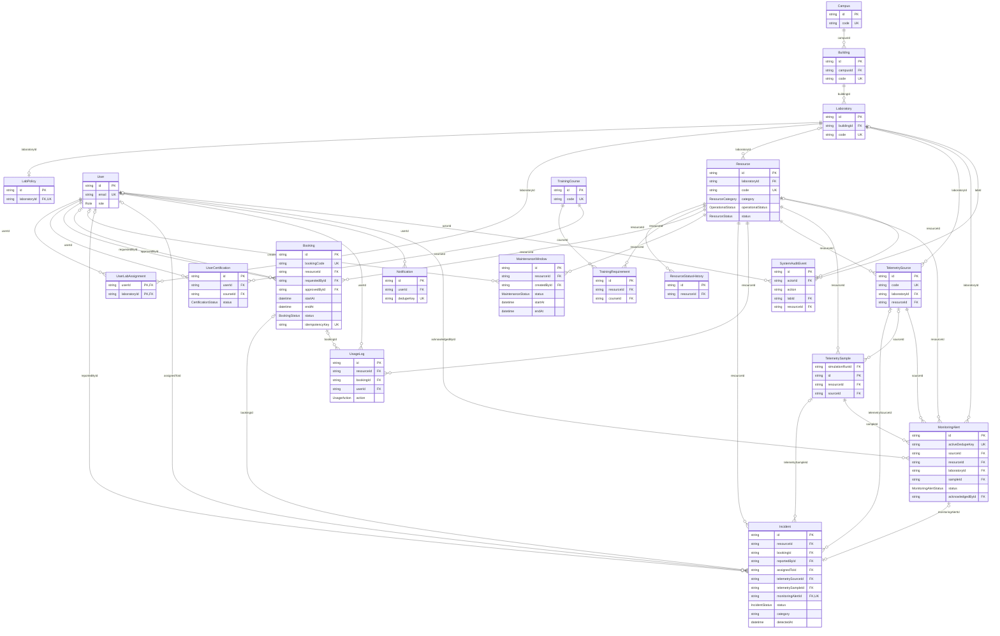
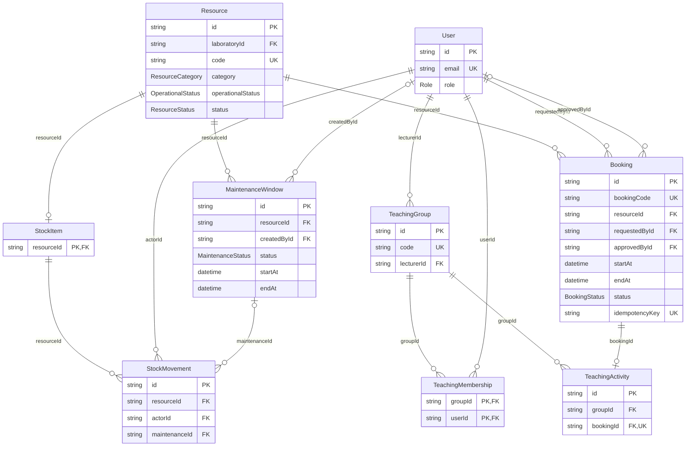
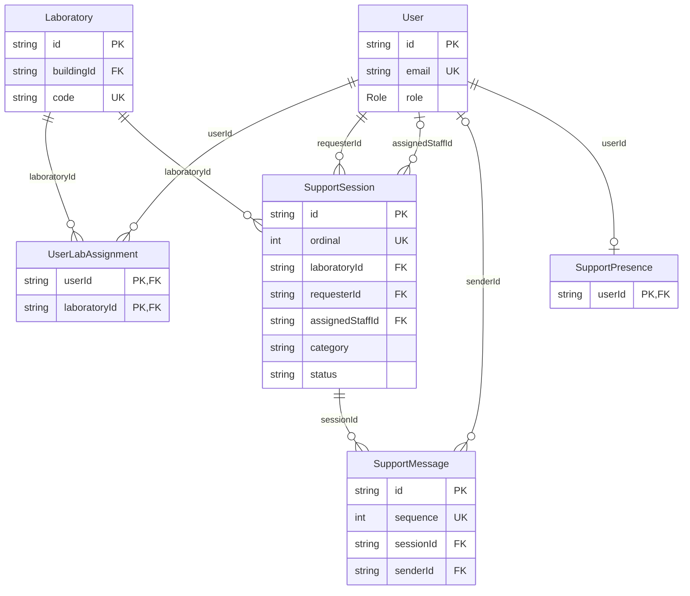
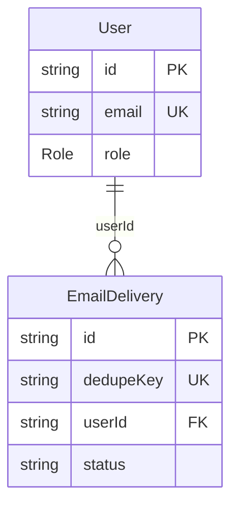
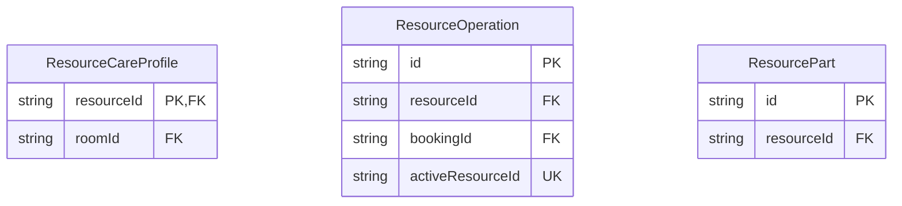

# Core laboratory data relationships

Generated from [canonical Prisma schema](../../backend/prisma/schema.prisma).
Schema SHA-256 after LF normalization: `4dc989c5f96ddd607d43820514ef6023d2f3394e5f1d290666036bd93709d3a8`.
Run `npm run docs:erd` in `backend/`; CI verifies `docs:erd:check`.
This is a selected model projection, not a claim that only these tables exist.
Foreign keys and cardinalities come from the generated Prisma data model checked
against the source schema. The current schema contains 56 models.

## Required booking operations and persisted monitoring

The 20 models cover identity/lab scope, resource policy, training eligibility,
booking, handover history, maintenance, incident handling, notification and
configured telemetry. Resource operational state and scheduling availability
remain separate. `UserLabAssignment` has a composite key; missing assignments
grant staff no laboratory access. Nullable relations are shown as optional.

PostgreSQL's `bookings_no_active_overlap` exclusion constraint and resource row
locks protect active booking intervals `[startAt, endAt)`. Prisma cannot express
the exclusion constraint; see tracked migrations and the concurrency tests.
History/audit records describe persisted events, not proof of physical inspection.

## Approved stock and teaching workspace extension

Stock movements record receipts, issues and admin adjustments. A maintenance-linked
issue must remain in the same laboratory. Teaching groups represent lecturer
supervision; academic endorsement does not grant resource approval or handover.
## Approved human support extension

Support sessions retain customer messages, staff replies, handling events and
resolution. Staff access follows current lab assignments. Partial unique indexes
enforce one open request per customer and one active session per staff member
across all labs. The presence heartbeat coordinates assignment; it does not prove
the staff member has read a message. See the forward support migration for
constraints that Prisma cannot express.

## Approved automatic email extension

Registration and verified VNPAY settlement enqueue immutable, password-free
email snapshots in the same transaction as their business event. Leased workers
send through configured SMTP after commit. SENT records SMTP acceptance, not
confirmed inbox delivery. Unique deduplication keys and state/attempt constraints
are maintained by the forward email migration. See ADR-030 for retry limits.

## Resource lifecycle extension

Virtual operations retain booking, actor, declared load and server timestamps.
Maintenance policy and component condition belong to existing catalogue resources.
Physical-state mutations remain explicit, scoped and history-backed.

Payment, shipment, AI, camera and optimization tables are outside this diagram's
core projection. Their presence in the schema does not certify those integrations.
