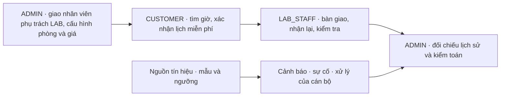

# Kịch bản báo cáo Lab Resource Manager

## Bộ dữ liệu trình diễn trên local và Vercel

| Vai trò | Tài khoản dùng trong kịch bản |
|---|---|
| ADMIN | Email Google của chủ workspace Railway, dùng cùng định danh trên hai bản |
| LAB_STAFF | Nguyễn Hoàng Minh (Điện tử), Trần Khánh Linh (Đo lường), Lê Tuấn Anh (cả hai LAB) |
| CUSTOMER | Phạm Thanh Hà |

Mỗi tài khoản có một mật khẩu cố định đã đồng bộ giữa local và cloud,
lưu trong kho mã hóa của tài khoản Windows. Đổi mật khẩu sau này chỉ
cập nhật môi trường đang sử dụng.
Chạy `./ops/Copy-LabLogin.ps1 -Environment cloud -Account admin` để sao chép
mật khẩu vào clipboard. Dùng `-Field email` để sao chép email, đổi
`cloud` thành `local` cho bản local. Các khóa tài khoản còn lại là
`staff-minh`, `staff-linh`, `staff-anh` và `customer`.

Trong màn tài nguyên, tìm `SHOW-` để lọc bảy phòng và bảy thiết bị theo
bảy trạng thái vận hành. Với dữ liệu ngày 20/11/2026, mở Lịch và thử đặt
`SHOW-ROOM-01` vào 09:00–10:00 (đã có lịch) và 13:00–14:00 (hiệu chuẩn).
Thiết bị `SHOW-DEVICE-01` có cửa sổ bảo trì 10:00–11:00. Màn Bảo trì có
phiếu ở cả bốn trạng thái. Mở sự cố mức cao của kính hiển vi số
`SHOW-DEVICE-05` để trình diễn luồng xử lý.

Local có mô phỏng nhiệt độ gắn nhãn của `SHOW-DEVICE-01`. Cloud trình
diễn dữ liệu vận hành và sự cố qua màn Giám sát. Các trạng thái tài nguyên
mẫu không phải chứng cứ kết nối cảm biến thật.

Khi cần lịch mới, `node ops/provision-showcase.mjs local` (hoặc `cloud`)
chạy lại qua API, giữ các bản ghi cũ. Cấp `LRM_SHOWCASE_ACCESS` chỉ trong
tiến trình chạy, dạng JSON gồm `bootstrap`, `admin`, `staff-minh`,
`staff-linh`, `staff-anh` và `customer`. Mỗi mục có `email` và `password`.
Với DB đã chuẩn bị, `bootstrap` dùng cùng tài khoản như `admin`. Khi tạo lại
từ DB trống, chuẩn bị LAB nền và các tài khoản local trước khi chạy.

**25 phút cho luồng chính**, thêm **5–10 phút hỏi đáp**. Dùng một phòng, một
lịch miễn phí và một nguồn giám sát kiểm thử để nối các màn hình. Chuẩn bị ba
hồ sơ trình duyệt riêng cho ADMIN, CUSTOMER và LAB_STAFF. Dùng giờ Việt Nam.

**Mở đầu (2 phút).** “Đây là hệ thống đặt phòng và thiết bị mở cho người có
nhu cầu. Ai cũng có thể đăng ký tài khoản khách hàng. Khi đặt, hệ thống kiểm
tra lịch trống và điều kiện của tài nguyên. Nhân viên phụ trách cơ sở xử lý
bàn giao, hoàn trả và sự cố. Em sẽ theo một lượt đặt từ danh mục đến lúc đối
chiếu nhật ký vận hành.”

## Chuẩn bị trước buổi báo cáo

- Kiểm tra đúng checkout và phiên bản. Với stack demo, xác nhận trang thật tại
  [localhost:5173](http://localhost:5173/) và API
  [readiness](http://127.0.0.1:8000/health/ready) báo database sẵn sàng. Kiểm tra
  trước cấu hình local và worker để tránh kích hoạt provider hoặc đổi dữ liệu
  demo. Các cổng kiểm thử tạm ghi trong [trạng thái](CURRENT_STATE.md) là bằng
  chứng của lượt tổng duyệt, chỉ dùng được khi stack kiểm thử tương ứng đang chạy.
  Dùng [hướng dẫn kiểm thử](SYSTEM_TEST_GUIDE.md) để chuẩn bị môi trường
  tách biệt. Nếu chưa mở được runtime, dùng sơ đồ, ERD và kết quả tổng duyệt.
- Chuẩn bị một phòng miễn phí bookable, tài khoản LAB_STAFF đã phân vào đúng
  LAB, một lịch đã hoàn tất, một hồ sơ cảnh báo có sự cố liên kết và một khung
  bảo trì có thể đối chiếu trên lịch. Chọn sẵn hồ sơ có thể trình chiếu, đóng
  các tab chứa thông tin tài khoản, mã phòng hay chi tiết liên hệ riêng.
- **Trên dữ liệu demo hiện có**, trình chiếu hồ sơ đã lưu hoặc mở form tới bước
  xem lại trên dữ liệu phù hợp với kiểm tra an toàn. **Muốn bấm lưu từ đầu đến
  cuối**, dùng stack và DB kiểm thử riêng. Nếu màn đọc có thể ghi phiên, chuyển
  trạng thái hết hạn hoặc tạo thông báo, chỉ chạy bước đó trên stack kiểm thử.
  Giữ VNPAY/VietQR, Google, SMTP, ChatGPT Work và model bên ngoài tắt trong
  lượt local này. Trình bày phần tích hợp bằng hồ sơ đã xác minh trước đó.
- Chọn trước thời điểm bàn giao. Tạo lịch yêu cầu giờ bắt đầu cách giờ server
  tối thiểu 30 phút hoặc lâu hơn theo chính sách LAB. Bàn giao mở từ
  `startAt − 30 phút` đến trước `endAt`. Ví dụ thao tác lúc 14:05, phòng còn
  khung 14:45–15:15 thì có thể bàn giao từ 14:15. Bảo trì dùng tài nguyên hoặc
  khung giờ khác. Nếu cửa sổ nhận chưa mở khi tới bước 4, chỉ mốc giờ trên lịch
  mới rồi chuyển sang lịch đã hoàn tất để tiếp tục.

## 1. ADMIN thiết lập quyền và dịch vụ · 4 phút

1. Mở **Quản trị người dùng** và chọn tài khoản nhân viên LAB_STAFF. Chỉ cơ sở
   hoặc nhóm tài nguyên (LAB) mà ADMIN giao nhân viên phụ trách. Mở phiên của
   nhân viên để đối chiếu quyền bàn giao, bảo trì và xử lý sự cố trong phạm vi
   đó. Backend đọc phân công từ `UserLabAssignment`. Khách hàng có thể đặt
   tài nguyên công khai ở các LAB theo lịch trống và điều kiện của từng tài nguyên.
2. Mở **Quản trị tài nguyên → Hồ sơ tài nguyên → Bảng giá thuê**. Chỉ mã, loại,
   LAB, tình trạng vật lý, điều kiện cho đặt và giá **0 đ/giờ** của phòng.
   Nếu dùng DB kiểm thử riêng, có thể tạo phòng mới và lưu giá, giới hạn 60 phút.

**Ý cần nói.** “Phân công, chính sách và giá là dữ liệu do ADMIN cấu hình.
API kiểm quyền ở mỗi yêu cầu. UI dùng các quyền này để dẫn người dùng đến
đúng việc.”

## 2. CUSTOMER tra cứu và đặt phòng · 5 phút

1. Mở trang công khai, tìm cùng phòng bằng mã, xem chi tiết và lịch. Chỉ khung
   bận công khai và phần giá. Có thể mở thêm một thiết bị có thông số tham
   chiếu hãng nếu giảng viên hỏi về dữ liệu danh mục mẫu.
2. Trong phiên CUSTOMER, chọn khung phù hợp, điền liên hệ kiểm thử và tới
   **xem lại báo giá**. Khung chỉ được giữ khi API đã tạo lịch. Nếu chạy trên DB kiểm thử
   riêng, bấm xác nhận rồi mở **Lịch đặt của tôi**, ghi nhớ mã lịch và mở
   **Thông báo**. Với giá 0 đ, lịch đủ điều kiện chuyển **Đã xác nhận** ngay.
3. Đối chiếu khung bận trên lịch. Nếu giảng viên hỏi về hai người cùng đặt,
   trình bày kết quả `409 BOOKING_CONFLICT` và quyền đọc hồ sơ theo chủ lịch
   trong phần kiểm chứng. Lịch công khai chỉ đưa thông tin phục vụ chọn giờ.

**Ý cần nói.** “Khung giờ khả dụng được tính từ trạng thái tài nguyên, lịch
đặt, bảo trì và chính sách. Bước lưu kiểm tra lại và PostgreSQL bảo vệ trường
hợp có hai yêu cầu tranh cùng khung, theo khoảng `[startAt, endAt)`.”

## 3. LAB_STAFF đọc tín hiệu, sự cố và bảo trì · 5 phút

1. Mở **Giám sát thiết bị → Nguồn cảm biến**, chọn hồ sơ đã chuẩn bị và
   chỉ tên nguồn, nhãn nguồn, timestamp, ngưỡng và mẫu đã lưu. Với kịch bản
   được phép ghi trên môi trường riêng, minh họa **tăng nhiệt → mất kết nối
   → phục hồi**. Nếu dùng mẫu tổng hợp qua API kiểm thử, nói rõ nguồn và mẫu
   phục vụ diễn tập. Chỉ nhãn **Mô phỏng** khi dùng mô phỏng tích hợp.
2. Mở cảnh báo và sự cố liên kết. Chỉ mẫu gây cảnh báo, mốc tiếp nhận và mốc
   phục hồi. Mất kết nối giữ cảnh báo nhiệt đang mở. Mẫu online mới đủ điều
   kiện làm cảnh báo kết thúc. Cán bộ vẫn xử lý sự cố theo quy trình riêng.
3. Mở **Bảo trì và hiệu chuẩn** rồi xem khoảng bị chặn trên lịch của tài
   nguyên tương ứng. Giải thích bảo trì tương lai ảnh hưởng khung giao nhau.
   Nếu có dữ liệu Windows đã được phép chiếu, dùng hồ sơ
   `DEMO-HOST-PC` để giải thích CPU/RAM/đĩa từng đo. Việc xác thực nguồn,
   độ mới của mẫu và phạm vi LAB đều được backend kiểm tra.

**Ý cần nói.** “Một luồng ghi nhận quyền sử dụng và giờ bàn giao thực tế.
Luồng giám sát ghi nhận tín hiệu, cảnh báo và sự cố. Cán bộ dùng bằng chứng đó
để xử lý. Trạng thái vật lý có quy trình cập nhật và lịch sử riêng.”

## 4. LAB_STAFF bàn giao, CUSTOMER đối chiếu · 5 phút

1. Vào **Lịch đặt và bàn giao** và tìm cùng mã lịch. Khi tới cửa sổ nhận trên
   DB kiểm thử riêng, nhập tình trạng lúc giao. Chỉ lịch **Đang sử dụng**
   và tài nguyên **Đang sử dụng**. Nếu dùng hồ sơ đã lưu, mở nhật ký lịch để
   chỉ mốc bàn giao.
2. CUSTOMER mở lại đúng lịch và đối chiếu kết quả. LAB_STAFF ghi tình trạng
   lúc nhận lại, xác nhận trả và hoàn tất sau kiểm tra. Chỉ từng mốc trong
   lịch sử `CONFIRMED → CHECKED_OUT → RETURNED → COMPLETED`. Khi đã ghi
   nhận hỏng hoặc bảo trì, hoàn trả giữ trạng thái vật lý đó.
3. Nếu giảng viên hỏi, khách có thể tự nhận/trả **phòng** khi đủ điều kiện,
   còn staff hoàn tất kiểm tra. Thiết bị dùng luồng bàn giao của staff.
   Chỉ dùng một cách nhận/trả cho lịch chính.

**Ý cần nói.** “Bàn giao và trạng thái vật lý cập nhật cùng transaction. Trả
và hoàn tất là hai mốc có người chịu trách nhiệm và ghi nhận riêng.”

## 5. ADMIN kết nối bằng chứng và chốt hướng đi · 4 phút

1. Mở **Nhật ký kiểm toán**, chọn hành động phân công, thay giá hoặc đối tượng
   đã thao tác. Chỉ ai làm, lúc nào và phạm vi LAB. Mở **Bảng điều khiển vận hành**,
   phân biệt lịch dự kiến với sử dụng thực tế ghi từ bàn giao và hoàn trả.
2. Dùng [cấu trúc dự án](PROJECT_STRUCTURE.md) và [ERD](DB-erd/core-erd.md)
   để giải thích React/Vite → API Express → kiểm quyền và service → Prisma/
   PostgreSQL. Theo bốn nhóm dữ liệu `UserLabAssignment`, `Resource`,
   `Booking` và lịch sử. Với giám sát, chỉ liên kết nguồn → mẫu → cảnh báo
   → sự cố.
3. Kết thúc bằng phạm vi hiện tại. “Em ưu tiên kiểm quyền, chống trùng lịch
   và lưu vết bàn giao. Cùng nền dữ liệu đó hỗ trợ giám sát và báo cáo.
   Thanh toán có bước xác minh server, còn trợ lý hỗ trợ tra cứu theo quyền.
   Phần cứng và dịch vụ ngoài cần nghiệm thu riêng.”

## Nhánh hỏi đáp

| Nếu được hỏi về | Mở đúng một màn và giải thích |
| --- | --- |
| Thanh toán | Mở một lịch có phí đang **Chờ thanh toán** nếu có hồ sơ phù hợp. Hạn giữ chỗ tối đa 15 phút và hết hạn giải phóng khung. Chỉ callback được server xác minh trước hạn mới xác nhận lịch. Có thể dùng biên lai lịch sử đã kiểm tra quyền và che thông tin riêng để giải thích VNPAY/VietQR. Trình bày rõ môi trường và ngày của bằng chứng. |
| Kho, điều phối và hỗ trợ | Mở một sổ nhập/xuất hoặc hồ sơ hỗ trợ đã lưu. Đổi lịch cần kiểm tra lại khung và lưu lý do. Yêu cầu hỗ trợ vào hàng đợi theo LAB và có người xử lý. |
| Tài khoản và bảo mật | Mở form đăng nhập/đăng ký email. Tự đăng ký tạo CUSTOMER. Dẫn tới ca từ chối khách khác và staff ngoài LAB để giải thích cách API kiểm quyền. |
| Chatbot và AI | Cho xem tra cứu nội bộ theo quyền hoặc bằng chứng đã lưu. Chỉ gửi câu tra cứu nội bộ khi stack kiểm thử đã chặn kết nối provider. Phần giải thích của model phụ thuộc cấu hình. Số liệu và quy tắc cảnh báo vẫn xem được trong hồ sơ nguồn. |
| Kế hoạch và báo cáo | Mở cùng hồ sơ tài nguyên hoặc báo cáo theo kỳ. Chỉ mốc dự kiến, mốc thực tế và bằng chứng vận hành. Dùng [kế hoạch đồ án](GRADUATION_PLAN.md) để trả lời phần tiếp theo. |

[Đặc tả nghiệp vụ](srs.md#4-functional-requirements) ·
[Kết quả kiểm chứng và việc cần làm trước buổi báo cáo](CURRENT_STATE.md)
