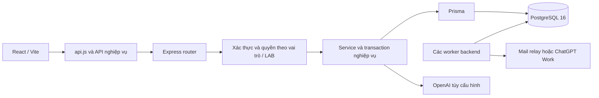

# Bản bàn giao kỹ thuật và tra cứu mã nguồn LAB Resource Manager

Mốc đối chiếu mã nguồn ngày **21/11/2026**. LAB Resource Manager là hệ thống quản lý phòng, thiết bị và lịch sử dụng phòng thí nghiệm. Luồng xuyên suốt là danh mục → tìm lịch → đặt và xác nhận → nhận, sử dụng, trả → theo dõi, bảo trì, xử lý sự cố và báo cáo. Trợ lý và chat hỗ trợ dùng cùng dữ liệu, phiên và vai trò của hệ thống.

Các liên kết `tệp:dòng» dưới đây mở đúng dòng trên GitHub. Khi checkout mới có thêm dòng, tìm theo tên hàm, model hoặc mẫu tuyến ghi bên cạnh. Đối chiếu mốc triển khai trong [CURRENT_STATE](CURRENT_STATE.md) trước khi kết luận về dữ liệu hoặc dịch vụ đang chạy.

## Cách dùng khi tiếp quản

1. Đọc [AGENTS](../AGENTS.md), [Context map](../.agent/CONTEXT_MAP.md), [SRS](srs.md), [PRODUCT](../PRODUCT.md) và các [ADR](DECISIONS.md) liên quan. Khi sửa frontend hoặc backend, đọc [quy tắc frontend](../frontend/AGENTS.md) hoặc [quy tắc backend](../backend/AGENTS.md).
2. Chọn mục nghiệp vụ trong bảng tra cứu. Bắt đầu từ màn hình, xem API mà màn gọi, tìm router được gắn trong `app.js», rồi đọc middleware, service, schema, migration và test cùng luồng.
3. Ghi rõ môi trường đang xét. Mã nguồn trong checkout, dữ liệu PostgreSQL local, dữ liệu Railway và biến môi trường của từng dịch vụ có thể ở các mốc khác nhau.
4. Khi trả lời câu hỏi về hành vi hệ thống, dẫn bằng `đường/dẫn:từng dòng», nêu điều kiện kích hoạt, vai trò, dữ liệu đọc/ghi và test kiểm chứng. Nếu nguồn là cấu hình hay kết quả chạy tại một mốc, ghi rõ mốc đó.

## Kiến trúc và thư mục

| Đường dẫn | Chứa gì và bắt đầu ở đâu |
|---|---|
| [frontend/src](../frontend/src) | React/Vite. [main.jsx:31](../frontend/src/main.jsx#L31), [workspaceRoutes.js:2](../frontend/src/workspaceRoutes.js#L2), [App.jsx:60](../frontend/src/App.jsx#L60). `pages/» chứa màn hình, `components/features/» chứa giao diện nghiệp vụ, `services/» và [api.js:38](../frontend/src/api.js#L38) quản lý lời gọi API, ánh xạ lỗi và deadline. |
| [backend/src](../backend/src) | Node.js/Express. [server.js:15](../backend/src/server.js#L15), [app.js:44](../backend/src/app.js#L44), [config.js:19](../backend/src/config.js#L19), [db.js:3](../backend/src/db.js#L3). `routes/» gắn URL và kiểm quyền, `services/» thực thi nghiệp vụ, `middleware/» xác thực, phân quyền và xử lý lỗi. |
| [backend/prisma](../backend/prisma) | [schema.prisma:5](../backend/prisma/schema.prisma#L5), [baseline đã duyệt](../backend/prisma/baseline), [migrations](../backend/prisma/migrations), và các script seed. Đọc migration cùng schema khi phân tích constraint, trigger hoặc tính tái lập trên DB mới. |
| [frontend/public](../frontend/public), [frontend/src/assets](../frontend/src/assets) | Nội dung tĩnh, hình ảnh, nguồn sử dụng. [Bộ ảnh CDN](../frontend/public/media/catalog) có tên theo nội dung và manifest credit. URL ảnh của từng tài nguyên được lưu ở DB. |
| [backend/test](../backend/test), [frontend](../frontend), [.github/workflows](../.github/workflows) | Unit, integration, Playwright và GitHub Actions. [package.json:50](../backend/package.json#L50), [package.json:32](../frontend/package.json#L32), [ci.yml:9](../.github/workflows/ci.yml#L9). |
| [data](../data), [ops](../ops), [infra](../infra), [firmware](../firmware) | Mẫu nhập tài nguyên, dữ liệu trình diễn có nhãn, backup/restore, giám sát, nguồn telemetry phần cứng tùy chọn. Xem [Real data runbook](REAL_DATA_RUNBOOK.md) trước khi nhập dữ liệu. |
| [plugins/lab-support-bridge](../plugins/lab-support-bridge) | Mã gói plugin ChatGPT Work, hướng dẫn đọc dữ liệu theo câu hỏi và trả kết quả về LAB. |
| [docs](README.md), [.agent](../.agent) | SRS, ADR, ERD, tài liệu kỹ thuật, kịch bản demo, hồ sơ đồ án, quy tắc cho agent. [PROJECT_STRUCTURE](PROJECT_STRUCTURE.md) có cây thư mục tổng thể. |



## Từ câu hỏi đến đúng tệp

| Câu hỏi cần tra | Giao diện và API | Xử lý, dữ liệu và kiểm thử |
|---|---|---|
| Đăng ký, đăng nhập, hết phiên ở đâu? | [AuthLoginView.tsx:39](../frontend/src/components/AuthLoginView.tsx#L39), [api.js:98](../frontend/src/api.js#L98), [auth.js:67](../backend/src/routes/auth.js#L67), [auth.js:109](../backend/src/routes/auth.js#L109) | [auth.js:26](../backend/src/middleware/auth.js#L26), [schema.prisma:337](../backend/prisma/schema.prisma#L337). Login kiểm tra bcrypt, tài khoản hoạt động và cấp phiên. Test [auth/RBAC](../backend/test/batch2.auth-rbac.integration.test.js) và [phiên đăng nhập](../backend/test/authSessions.integration.test.js). |
| Đăng nhập Google, OTP đổi mật khẩu, đổi quyền user? | [GoogleSignIn.tsx:26](../frontend/src/components/features/auth/GoogleSignIn.tsx#L26), [auth.js:53](../backend/src/routes/auth.js#L53), [auth.js:177](../backend/src/routes/auth.js#L177), [app.js:145](../backend/src/app.js#L145) | [passwordSecurityService.js:33](../backend/src/services/passwordSecurityService.js#L33), [passwordSecurityService.js:80](../backend/src/services/passwordSecurityService.js#L80), [accountManagementService.js:46](../backend/src/services/accountManagementService.js#L46). Test [Google](../backend/test/googleAuth.integration.test.js) và [quản trị tài khoản](../backend/test/accountSecurity.integration.test.js). |
| Danh mục, trang chi tiết, trạng thái và ảnh? | [PublicResourceCatalog.tsx:122](../frontend/src/components/PublicResourceCatalog.tsx#L122), [ResourceDetailPage.tsx:64](../frontend/src/pages/ResourceDetailPage.tsx#L64), [resources.js:184](../backend/src/routes/resources.js#L184), [resources.js:409](../backend/src/routes/resources.js#L409) | [resourceService.js:104](../backend/src/services/resourceService.js#L104), [resourceService.js:230](../backend/src/services/resourceService.js#L230), [schema.prisma:484](../backend/prisma/schema.prisma#L484), [schema.prisma:547](../backend/prisma/schema.prisma#L547). Test [quản lý tài nguyên](../backend/test/batch3.resource-management.integration.test.js) và [media](../backend/test/resourceMedia.test.js). |
| WebP/CDN, thêm, sửa và lưu ảnh tài nguyên? | [ResourceGallery.tsx:13](../frontend/src/components/ResourceGallery.tsx#L13), [app.js:150](../backend/src/app.js#L150), [vercel.mjs:25](../frontend/vercel.mjs#L25) | [resourceMediaService.js:50](../backend/src/services/resourceMediaService.js#L50), [resourceMediaService.js:59](../backend/src/services/resourceMediaService.js#L59), [resourceMediaService.js:74](../backend/src/services/resourceMediaService.js#L74). DB lưu metadata và nguồn, file có thể ở CDN hoặc object storage. Test [delivery frontend](../frontend/test_media_delivery.mjs). |
| Xem lịch, tính slot trống hay lọc trùng? | [SmartCalendarView.tsx:26](../frontend/src/components/SmartCalendarView.tsx#L26), [app.js:156](../backend/src/app.js#L156), [bookings.js:129](../backend/src/routes/bookings.js#L129) | [availabilityService.js:132](../backend/src/services/availabilityService.js#L132), [availabilityService.js:270](../backend/src/services/availabilityService.js#L270), [migration.sql:10](../backend/prisma/migrations/20260820000100_add_booking_guard_constraint/migration.sql#L10). Test [calendar/policy](../backend/test/batch4.booking-calendar.integration.test.js) và [tranh chấp slot](../backend/test/bookingConcurrency.db.test.js). |
| Khách đặt nhanh có OTP xử lý ra sao? | [GuestQuickBookingPanel.tsx:260](../frontend/src/components/GuestQuickBookingPanel.tsx#L260), [GuestQuickBookingPanel.tsx:281](../frontend/src/components/GuestQuickBookingPanel.tsx#L281), [guestBooking.js:48](../backend/src/routes/guestBooking.js#L48), [guestBooking.js:53](../backend/src/routes/guestBooking.js#L53) | [guestBookingService.js:88](../backend/src/services/guestBookingService.js#L88), [guestBookingService.js:200](../backend/src/services/guestBookingService.js#L200), [schema.prisma:467](../backend/prisma/schema.prisma#L467). Tạo hoặc nối danh tính và đặt lịch theo transaction, test [guest integrity](../backend/test/guestBookingIntegrity.integration.test.js). |
| Đã đăng nhập thì đặt, đổi, hủy lịch ở đâu? | [QuickBookingModal.tsx:336](../frontend/src/components/QuickBookingModal.tsx#L336), [BookingOperationsPage.tsx:11](../frontend/src/pages/operations/BookingOperationsPage.tsx#L11), [bookings.js:26](../backend/src/routes/bookings.js#L26), [bookings.js:34](../backend/src/routes/bookings.js#L34) | [bookingService.js:215](../backend/src/services/bookingService.js#L215), [bookingService.js:305](../backend/src/services/bookingService.js#L305), [bookingService.js:576](../backend/src/services/bookingService.js#L576), [schema.prisma:644](../backend/prisma/schema.prisma#L644). |
| Giá theo giờ, giữ chỗ và thanh toán được xác nhận thế nào? | [BookingCheckout.tsx:22](../frontend/src/components/features/payments/BookingCheckout.tsx#L22), [bookingPricing.js:61](../backend/src/routes/bookingPricing.js#L61), [payments.js:43](../backend/src/routes/payments.js#L43), [payments.js:86](../backend/src/routes/payments.js#L86) | [bookingPricingService.js:10](../backend/src/services/bookingPricingService.js#L10), [bookingPaymentHoldService.js:43](../backend/src/services/bookingPaymentHoldService.js#L43), [paymentService.js:372](../backend/src/services/paymentService.js#L372), [paymentService.js:415](../backend/src/services/paymentService.js#L415), [schema.prisma:1146](../backend/prisma/schema.prisma#L1146). Test [giữ chỗ](../backend/test/paymentHold.integration.test.js) và [đối soát](../backend/test/phaseH.payment-lifecycle.integration.test.js). |
| Bàn giao, mã mở phòng, tự nhận/trả, hoàn tất lịch? | [BookingAccessPanel.tsx:9](../frontend/src/components/features/operations/BookingAccessPanel.tsx#L9), [bookings.js:261](../backend/src/routes/bookings.js#L261), [bookings.js:305](../backend/src/routes/bookings.js#L305) | [bookingFulfillmentService.js:137](../backend/src/services/bookingFulfillmentService.js#L137), [bookingService.js:342](../backend/src/services/bookingService.js#L342), [bookingService.js:513](../backend/src/services/bookingService.js#L513), [dịch vụ mã mở phòng](../backend/src/services/bookingRoomAccessCode.js). Test [fulfillment](../backend/test/bookingFulfillment.integration.test.js). |
| Bảo trì, hiệu chuẩn, linh kiện và lịch bị ảnh hưởng? | [MaintenancePage.tsx:77](../frontend/src/pages/MaintenancePage.tsx#L77), [maintenance.js:65](../backend/src/routes/maintenance.js#L65), [maintenance.js:116](../backend/src/routes/maintenance.js#L116), [app.js:180](../backend/src/app.js#L180) | [resourceCareService.js:46](../backend/src/services/resourceCareService.js#L46), [schema.prisma:758](../backend/prisma/schema.prisma#L758), [schema.prisma:1492](../backend/prisma/schema.prisma#L1492), [migration.sql:29](../backend/prisma/migrations/20261014000200_released_booking_maintenance_guard/migration.sql#L29). Test [resource care](../backend/test/resourceCare.integration.test.js). |
| Dashboard nhận nhiệt độ, cảnh báo hay camera thế nào? | [MonitoringDashboardPage](../frontend/src/pages/monitoring/MonitoringDashboardPage.tsx), [telemetry.js:114](../backend/src/routes/telemetry.js#L114), [telemetry.js:171](../backend/src/routes/telemetry.js#L171), [telemetry.js:181](../backend/src/routes/telemetry.js#L181) | [telemetryIdentityService.js:89](../backend/src/services/telemetryIdentityService.js#L89), [telemetryService.js:282](../backend/src/services/telemetryService.js#L282), [monitoringSimulationService.js:96](../backend/src/services/monitoringSimulationService.js#L96), [monitoringAlertService.js:34](../backend/src/services/monitoringAlertService.js#L34). Test [smart monitoring](../backend/test/batch8.smart-monitoring.integration.test.js) và [demo](../backend/test/demoMonitoring.test.js). |
| Báo sự cố, thông báo staff và audit ở đâu? | [IncidentsPage](../frontend/src/pages/incidents/IncidentsPage.tsx), [AuditLogsPage](../frontend/src/pages/AuditLogsPage.tsx), [app.js:178](../backend/src/app.js#L178), [app.js:177](../backend/src/app.js#L177) | [operatorAlertService.js:20](../backend/src/services/operatorAlertService.js#L20), [systemAuditService](../backend/src/services/systemAuditService.js), [schema.prisma:781](../backend/prisma/schema.prisma#L781), [schema.prisma:860](../backend/prisma/schema.prisma#L860), [schema.prisma:1449](../backend/prisma/schema.prisma#L1449). Test [thông báo/sự cố](../backend/test/batch6.notifications-incidents-dashboard.integration.test.js) và [audit](../backend/test/operationalAudit.integration.test.js). |
| Kho vật tư, công việc theo LAB và phân trang? | [LabWorkspace.tsx:5](../frontend/src/pages/LabWorkspace.tsx#L5), [app.js:164](../backend/src/app.js#L164), [API hàng đợi](WORKSPACE_QUEUE_PAGINATION_20261003.md) | [labWorkspaceService.js:27](../backend/src/services/labWorkspaceService.js#L27), [workspaceQueueService](../backend/src/services/workspaceQueueService.js), [schema.prisma:1373](../backend/prisma/schema.prisma#L1373), [schema.prisma:1353](../backend/prisma/schema.prisma#L1353). Test [LAB workspace](../backend/test/labWorkspace.integration.test.js) và [hàng đợi](../backend/test/queuePagination.integration.test.js). |
| Chọn nhiều tài nguyên, gợi ý lịch, chờ lịch và checklist? | [SelectionPage.tsx:37](../frontend/src/pages/SelectionPage.tsx#L37), [planningApi](../frontend/src/services/planningApi.ts), [planning.js:25](../backend/src/routes/planning.js#L25), [planning.js:35](../backend/src/routes/planning.js#L35) | [bundleService.js:60](../backend/src/services/planning/bundleService.js#L60), [waitlistService](../backend/src/services/planning/waitlistService.js), [dossierService.js:27](../backend/src/services/planning/dossierService.js#L27), [schema.prisma:700](../backend/prisma/schema.prisma#L700). Test [planning](../backend/test/planning.integration.test.js). |
| Chat với staff, tự giao và lưu tin nhắn ở đâu? | [CustomerSupportChat.tsx:14](../frontend/src/components/features/support/CustomerSupportChat.tsx#L14), [SupportPage](../frontend/src/components/features/support/SupportPage.tsx), [support.js:37](../backend/src/routes/support.js#L37) | [supportService.js:23](../backend/src/services/supportService.js#L23), [schema.prisma:414](../backend/prisma/schema.prisma#L414), [schema.prisma:440](../backend/prisma/schema.prisma#L440). Test [support](../backend/test/support.integration.test.js), [UI support](../frontend/test_support_ui.mjs). |
| Chatbot gọi dữ liệu, OpenAI hoặc Work như thế nào? | [LaboratoryAssistant.tsx:180](../frontend/src/components/features/assistant/LaboratoryAssistant.tsx#L180), [chatgptBridgeApi.ts:69](../frontend/src/services/chatgptBridgeApi.ts#L69), [assistant.js:31](../backend/src/routes/assistant.js#L31), [chatgptBridgeRequests.js:21](../backend/src/routes/chatgptBridgeRequests.js#L21) | [assistantService.js:163](../backend/src/assistant/assistantService.js#L163), [mcpServer.js:11](../backend/src/assistant/mcpServer.js#L11), [assistantModel.js:77](../backend/src/assistant/assistantModel.js#L77), [events.js:126](../backend/src/chatgptBridge/events.js#L126). Test [assistant](../backend/test/assistant.integration.test.js), [Work](../backend/test/chatgptBridge.integration.test.js), [phản hồi từng phần](../frontend/test_chatgpt_bridge.mjs). |
| Email gửi ngay, email tự động và relay Google ở đâu? | [guestBookingService.js:88](../backend/src/services/guestBookingService.js#L88), [passwordSecurityService.js:33](../backend/src/services/passwordSecurityService.js#L33), [emailAutomationService.js:29](../backend/src/services/emailAutomationService.js#L29) | [emailAutomationService.js:136](../backend/src/services/emailAutomationService.js#L136), [emailService.js:78](../backend/src/services/emailService.js#L78), [googleScriptMail.js:11](../backend/src/services/googleScriptMail.js#L11), [Code.gs:6](../ops/google-apps-script/Code.gs#L6), [schema.prisma:389](../backend/prisma/schema.prisma#L389). Test [outbox](../backend/test/emailAutomation.integration.test.js) và [relay](../backend/test/googleScriptMail.test.js). |
| Đổi ngôn ngữ, mặc định nền sáng hoặc cấu hình menu? | [LocaleProvider.tsx:10](../frontend/src/providers/LocaleProvider.tsx#L10), [ThemeProvider.tsx:6](../frontend/src/providers/ThemeProvider.tsx#L6), [workspaceRoutes.js:45](../frontend/src/workspaceRoutes.js#L45), [AppLayout](../frontend/src/components/AppLayout.tsx) | [Catalog frontend](../frontend/src/locales/catalog), [locale backend](../backend/src/locales), [đồng bộ locale](../frontend/scripts/syncLocales.mjs). Menu phản ánh quyền, API vẫn kiểm tra quyền và dữ liệu thực. |

## Cách các luồng nghiệp vụ chạy

### Tài khoản và ranh giới quyền

- Ba vai trò nằm trong [roles.js:13](../backend/src/constants/roles.js#L13) và [schema.prisma:20](../backend/prisma/schema.prisma#L20). `ADMIN» quản trị toàn hệ thống, `LAB_STAFF» thao tác nghiệp vụ theo phân công hiện tại, `CUSTOMER» xem và thao tác dữ liệu thuộc mình. [ADR-034](DECISIONS.md#adr-034--quản-lý-khách-hàng-và-đổi-mật-khẩu-có-otp-13102026) cho staff quản lý CUSTOMER qua API tài khoản trong phạm vi riêng của nghiệp vụ đó.
- Frontend giữ token theo phiên trong [authStorage](../frontend/src/services/authStorage.js). Backend kiểm tra phiên, phiên bản xác thực và trạng thái user trong [auth middleware](../backend/src/middleware/auth.js) và [authTokens](../backend/src/services/authTokens.js). Sửa giới hạn của staff ở [labScope](../backend/src/middleware/labScope.js) và service có scope tương ứng.
- OTP đổi mật khẩu đòi kiểm chứng challenge còn hạn. Đổi credential thu hồi phiên liên quan. Đăng nhập Google kiểm chứng danh tính thông qua [googleAuthService](../backend/src/services/googleAuthService.js). Frontend chỉ hiển thị lựa chọn Google khi có cấu hình.

### Tài nguyên, lịch khả dụng và xung đột

- [schema.prisma:38](../backend/prisma/schema.prisma#L38) gồm `ROOM», `EQUIPMENT», `MACHINE», `EXPERIMENT_KIT», `MATERIAL». Cột subtype mô tả loại kỹ thuật. [schema.prisma:47](../backend/prisma/schema.prisma#L47) là trạng thái vật lý chuẩn. `Resource.status» phục vụ tương thích, còn trạng thái có thể đặt được được tính từ lịch và quy tắc.
- `preflight» chỉ đọc. Backend kiểm tra [lead time](../backend/src/services/bookingNoticePolicy.js), chính sách LAB, [huấn luyện/chứng nhận](../backend/src/services/trainingEligibilityService.js), tình trạng vật lý, hồ sơ bảo trì, slot và giá. Khi gửi lệnh đặt thật, transaction đọc lại các điều kiện quan trọng.
- Khoảng giờ là nửa mở `[startAt, endAt)» và quy tắc ngày/giờ đi theo `Asia/Ho_Chi_Minh». Hai lượt trùng chạy đồng thời còn bị chặn bằng constraint DB và lock trong luồng ghi. Khi sửa logic trùng, kiểm thêm biên giáp giờ, hủy/đổi lịch, bảo trì chồng và thanh toán hết hạn.
- Danh mục công khai ẩn tài nguyên `RETIRED». Màn quản trị dùng dữ liệu thực tế cùng [resourceService.js:48](../backend/src/services/resourceService.js#L48). Hình ảnh minh họa theo model hay công năng được ghi nguồn trong [danh mục tĩnh](../frontend/public/media/catalog).

### Đặt và thanh toán

- Luồng thường tạo `CONFIRMED» nếu hợp lệ và giá bằng 0. Với giá dương, service lưu `PENDING_APPROVAL» cùng `paymentDueAt = min(lúc tạo + 15 phút, lúc bắt đầu)». Đây là giữ chỗ chờ thanh toán. Dữ liệu cũ `PENDING_APPROVAL» thiếu `paymentDueAt» vẫn dùng nhánh duyệt/từ chối cũ.
- Báo giá lấy biểu giá theo mục đích, thời lượng, phiên bản và quyền lợi hồ sơ khi áp dụng. [bookingPricingService.js:36](../backend/src/services/bookingPricingService.js#L36) phát hiện báo giá đã đổi. Luồng guest kiểm OTP có hạn và xử lý thông tin liên hệ cùng transaction của booking.
- Thời điểm thanh toán được xác nhận từ IPN hoặc webhook đã kiểm tra. Giao diện return của provider dẫn người dùng về màn kiểm tra giao dịch. [bookingPaymentHoldService.js:33](../backend/src/services/bookingPaymentHoldService.js#L33) chỉ xác nhận giữ chỗ hợp lệ. Tiền báo có muộn vào đối soát và lịch hết hạn vẫn đã hủy. [ADR thanh toán và đối soát](DECISIONS.md).

### Nhận, trả và bảo trì

- Luồng chính `CONFIRMED → CHECKED_OUT → RETURNED → COMPLETED». `REJECTED» và `CANCELLED» là trạng thái kết thúc khác. `NO_SHOW» là kết quả/sự kiện riêng. Xem [schema.prisma:72](../backend/prisma/schema.prisma#L72) và [schema.prisma:82](../backend/prisma/schema.prisma#L82).
- Quyền nhận tài nguyên còn phụ thuộc vào giờ bàn giao, đã thanh toán nếu có phí, chế độ bàn giao và trạng thái được phép. Luồng tự nhận phòng dùng cấu hình `ResourceFulfillment» và [mã truy cập phòng](../backend/src/services/bookingRoomAccessCode.js). Thao tác nhận/trả ghi lịch sử, đồng bộ trạng thái vật lý ở các bước phù hợp và bảo toàn cửa sổ đã sử dụng.
- Kiểm tra tác động của bảo trì dùng route `/api/maintenance/impact». Lệnh vận hành lưu record riêng trong `ResourceOperation» hoặc `MaintenanceWindow». Sửa trạng thái thiết bị cần đọc thêm [resourceCareModel](../backend/src/services/resourceCareModel.js), [resourceCareAccounting](../backend/src/services/resourceCareAccounting.js) và cơ chế chống xung đột DB.

### Giám sát, sự cố và báo cáo

- Nguồn telemetry được định danh theo tài nguyên và LAB. Ingest kiểm timestamp, dữ liệu và thông tin xác thực nguồn. Ngưỡng theo tài nguyên ưu tiên hơn ngưỡng LAB khi được cấu hình, rồi dùng mặc định áp dụng. Cảnh báo và mẫu có vòng đời riêng trong [schema.prisma:884](../backend/prisma/schema.prisma#L884) và [schema.prisma:979](../backend/prisma/schema.prisma#L979). Nếu muốn chỉnh xử lý mất tín hiệu, đọc [telemetryLivenessService](../backend/src/services/telemetryLivenessService.js).
- Mô phỏng tạo `MonitoringSimulationRun» và mẫu được gắn nhãn; dùng [hướng dẫn demo](GRADUATION_DEMO_RUNBOOK.md) và [monitoringSimulationService.js:9](../backend/src/services/monitoringSimulationService.js#L9). Camera dùng luồng kiểm quyền và audit truy cập trong [cameraService](../backend/src/services/cameraService.js).
- [incidentService](../backend/src/services/incidentService.js) xử lý vòng đời sự cố. [notificationService](../backend/src/services/notificationService.js) và [operatorAlertService](../backend/src/services/operatorAlertService.js) xử lý cảnh báo, thông báo theo vai trò và LAB. Các số tổng hợp lấy từ [operationsReportService.js:6](../backend/src/services/operationsReportService.js#L6) và [dashboardService](../backend/src/services/dashboardService.js).

### Hỗ trợ và các đường phản hồi của chatbot

- Chat staff có phiên bền và tin nhắn. `WAITING» đi vào hàng đợi theo LAB, `ACTIVE» có staff nhận, `CLOSED» dùng để xem lại. Bộ nhận xác minh user hiện tại, scope LAB và trạng thái phiên cho mỗi phép đọc/ghi. Gửi tin và nhắc lại chọn đúng API, tránh tạo phiên trùng.
- Trợ lý có ba đường phản hồi. Câu tra cứu rõ ràng xử lý nhanh dựa trên dữ liệu LAB và các quy tắc đã kiểm tra tại [fastQueries](../backend/src/assistant/fastQueries.js). Khi có OpenAI key và model, Responses API lập kế hoạch rồi backend kiểm schema trước khi gọi các tool MCP đọc dữ liệu. Backend giữ quyền kiểm tra và các thao tác ghi qua form chuẩn.
- Work dùng [OAuth của LAB](../backend/src/chatgptBridge/oauth.js) và [MCP bridge](../backend/src/chatgptBridge/mcp.js). ADMIN cấp quyền, một bộ nhận Work subscribe, LAB tạo request/outbox và worker phát sự kiện. [requests](../backend/src/chatgptBridge/requests.js) giới hạn context theo phiên và người hỏi. Công cụ trả về phần tạm hay câu trả lời cuối. Đề xuất được đưa vào biểu mẫu để người dùng xác nhận tiếp.
- Luồng OpenAI kiểm [assistantModel](../backend/src/assistant/assistantModel.js), [assistantRuntime](../backend/src/assistant/assistantRuntime.js) và [assistantConversation](../backend/src/assistant/assistantConversation.js) khi chậm hoặc timeout. Luồng Work kiểm grant, subscription, outbox rồi kiểm polling. Tách thời gian xử lý LAB, thời gian đánh thức worker và thời gian nhà cung cấp sinh câu. [MCP contract](AI_ASSISTANT_MCP.md) và [setup](AI_ASSISTANT_SETUP.md) có giới hạn cụ thể.

### Hồ sơ, địa chỉ và dữ liệu bổ trợ

| Nhu cầu | Điểm xử lý |
|---|---|
| Địa chỉ cho hồ sơ và đặt nhanh | [ProfilePage](../frontend/src/pages/ProfilePage.tsx) → [address.js:7](../backend/src/routes/address.js#L7) → [validateVietnamAddress](../backend/src/services/addressService.js#L82). Mã tỉnh/xã được xác minh khi lưu. Service có cache dữ liệu tra cứu và ghi nguồn. |
| Cấp độ khách và giảm giá | [loyalty.js:9](../backend/src/routes/loyalty.js#L9) → [getVerifiedSpend](../backend/src/services/loyaltyService.js#L49) → [getUserLoyalty](../backend/src/services/loyaltyService.js#L69) → [quoteBooking](../backend/src/services/bookingPricingService.js#L10). Thay đổi quyền lợi kiểm cả phiên bản policy và giao dịch được xác thực. |
| Báo cáo, xu hướng, tổng quan vận hành | [dashboard.js:16](../backend/src/routes/dashboard.js#L16), [dashboard.js:34](../backend/src/routes/dashboard.js#L34), [operationsBriefService](../backend/src/services/operationsBriefService.js), [workspaceTrendsService](../backend/src/services/workspaceTrendsService.js) và [buildOperationsReport](../backend/src/services/operationsReportService.js#L6). Phạm vi staff đi theo phân công LAB. |
| Nhóm học tập, huấn luyện và chứng nhận | [labWorkspace](../backend/src/routes/labWorkspace.js), [trainingEligibilityService](../backend/src/services/trainingEligibilityService.js), [UserCertification](../backend/prisma/schema.prisma#L623), [TeachingGroup](../backend/prisma/schema.prisma#L1391). Xem [test training](../backend/test/trainingEligibility.test.js) khi thay điều kiện cho phép đặt hoặc sử dụng. |

### Email và nhắc việc

- OTP gửi qua transport đồng bộ trong luồng yêu cầu. Thư chào mừng và biên nhận đi vào outbox theo `dedupeKey». Worker claim theo lease, gửi rồi ghi `SENT» hoặc retry. Xem [emailAutomationService.js:188](../backend/src/services/emailAutomationService.js#L188) và [server.js:22](../backend/src/server.js#L22).
- Transport chọn từ `EMAIL_TRANSPORT». SMTP dùng cấu hình riêng. Relay Google yêu cầu URL HTTPS `/exec», token backend và Script Property `LAB_MAIL_TOKEN» quyết định quyền gửi. `SENT» xác nhận nhà vận chuyển nhận yêu cầu, còn kiểm chứng tới hộp thư là bước riêng. Tiến trình kiểm tra ở [checkEmailSetup](../backend/scripts/checkEmailSetup.mjs).
- `OPERATOR_ALERT_EMAILS_ENABLED» là tùy chọn của email cảnh báo staff. Thông báo trong ứng dụng có luồng riêng từ alert và [hook](../frontend/src/hooks/useWorkspaceNotifications.js).

## Triển khai, dữ liệu và điểm kiểm tra

| Câu hỏi triển khai | Nơi tra |
|---|---|
| Bật bản local theo tài liệu | [README](../README.md#chạy-local), [dev-local.mjs:9](../frontend/scripts/dev-local.mjs#L9), [Docker Compose local](../docker-compose.local.yml). UI mặc định cổng 5173, API 8000 theo cấu hình được ghi. Dùng `npm ci» ở từng gói và đọc guard trước khi seed hoặc import. |
| GitHub, Vercel, Railway và Compose nằm đâu? | [vercel.mjs:15](../frontend/vercel.mjs#L15), [railway.json:7](../backend/railway.json#L7), [Docker Compose production](../docker-compose.prod.yml), [Deployment](DEPLOYMENT.md). Vercel xử lý website và rewrite `/api», Railway chạy API và PostgreSQL riêng. Push GitHub cập nhật mã nguồn. Xem release pipeline trước khi suy ra trạng thái app live. |
| Kiểm tra startup, schema và restore | [app.js:114](../backend/src/app.js#L114), [deployCanonicalMigrations](../backend/scripts/deployCanonicalMigrations.mjs), [seedAdmin](../backend/prisma/seedAdmin.js), [backup](../ops/backup-postgres.ps1), [restore](../ops/restore-postgres.ps1). Migration forward giữ lịch sử đã áp dụng. Thử restore vào DB riêng trước khi vận hành thật. |
| Test đầy đủ thế nào? | [runReleaseIntegration.mjs:20](../backend/scripts/runReleaseIntegration.mjs#L20), [package.json:32](../frontend/package.json#L32), [package.json:50](../backend/package.json#L50), [System test guide](SYSTEM_TEST_GUIDE.md), [GitHub Actions](../.github/workflows). Test DB sử dụng PostgreSQL 16 cô lập. |
| Biến môi trường và dữ liệu demo ở đâu? | [.env.example](../.env.example), [.env.production.example](../.env.production.example), [Deploy](DEPLOYMENT.md), [Demo runbook](GRADUATION_DEMO_RUNBOOK.md). Tài khoản triển khai, token, DB vận hành và cấu hình thực phải lấy từ môi trường được quyền sử dụng. |

### Mốc cloud được ghi trong dự án

- [Bản deploy](https://lab-resource-manager-demo.vercel.app) dùng API và DB khác local. Checkpoint đã ghi 104 tài nguyên có ảnh, trong đó có đủ 101 mã từ local tại mốc nhập danh mục. Hai tài nguyên ngừng sử dụng được giữ trong hệ thống quản trị. Số đo thời gian tải là phép đo tại thời điểm ghi trong [CURRENT_STATE](CURRENT_STATE.md).
- Mốc email xác nhận backend gọi được Apps Script và bật outbox. Mốc trợ lý xác nhận tra cứu nội bộ, có đầu nối Work và có tùy chọn OpenAI khi thiết lập khóa. Kiểm tra lại `/api/assistant/suggestions» bằng tài khoản được quyền để biết mode tại thời điểm điều tra. Xem [AI setup](AI_ASSISTANT_SETUP.md).
- Thanh toán thật và nguồn telemetry thật phụ thuộc cấu hình môi trường. Báo cáo kiểm thử có ca sandbox, mô phỏng, thử nghiệm cô lập và thử trên website. Khi trích bằng chứng, nói rõ loại phép thử. Xem [hồ sơ nộp và minh chứng](README.md#báo-cáo-đồ-án-tốt-nghiệp).

## Ví dụ tra cứu nhanh cho AI

| Câu hỏi | Thứ tự đọc và điểm cần xác minh |
|---|---|
| “Hai khách bấm đặt cùng giờ thì sao?” | [bookings.js:238](../backend/src/routes/bookings.js#L238) → [bookingService.js:215](../backend/src/services/bookingService.js#L215) → [migration.sql:10](../backend/prisma/migrations/20260820000100_add_booking_guard_constraint/migration.sql#L10) → [test concurrency](../backend/test/bookingConcurrency.db.test.js). Xác định interval, trạng thái giữ chỗ, lỗi xung đột và điều kiện trả slot. |
| “Thanh toán đến sau khi lịch hết hạn xử lý ở đâu?” | [paymentService.js:372](../backend/src/services/paymentService.js#L372) → [bookingPaymentHoldService.js:43](../backend/src/services/bookingPaymentHoldService.js#L43) → [đối soát](../backend/test/phaseH.payment-lifecycle.integration.test.js). Kiểm trạng thái payment và booking riêng. |
| “Nhân viên mở hồ sơ LAB khác thì có thấy dữ liệu không?” | [labScope](../backend/src/middleware/labScope.js) → [schema.prisma:1353](../backend/prisma/schema.prisma#L1353) → route/service đích → [test RBAC](../backend/test/batch2.auth-rbac.integration.test.js). Kiểm từng hành động và dữ liệu trả về, kể cả trường hợp ngoại lệ của account API. |
| “Tại sao email không vào hộp thư?” | [Người gửi và relay](DEPLOYMENT.md#google-apps-script-mail-for-railway) → [googleScriptMail.js:11](../backend/src/services/googleScriptMail.js#L11) → [emailAutomationService.js:136](../backend/src/services/emailAutomationService.js#L136). Xác định OTP gửi ngay hay outbox, runtime flag, trạng thái, số lần thử rồi kiểm hộp thư đích. |
| “Vì sao câu hỏi AI hiện kết quả chậm?” | [LaboratoryAssistant.tsx:180](../frontend/src/components/features/assistant/LaboratoryAssistant.tsx#L180) → [assistant.js:13](../backend/src/routes/assistant.js#L13) → OpenAI hoặc Work theo mode → kiểm provider, trạng thái pending, partial, deadline và thời gian đã đo trên đúng môi trường. |
| “Muốn sửa lời tiếng Việt hiển thị sai ở màn chi tiết?” | [ResourceDetailPage.tsx:64](../frontend/src/pages/ResourceDetailPage.tsx#L64) hoặc component đang render → [catalog VI](../frontend/src/locales/catalog/vi.json) → [sync locale](../frontend/scripts/syncLocales.mjs) nếu key dùng chung với backend → test UI/locale phù hợp. |

## Kiểm tra nhanh tại một checkout

```powershell
git status -sb
git log -1 --oneline
rg -n 'createBookingWithTransaction|bookings_no_active_overlap' backend
rg -n 'guest-booking|assistant/chat|assistant/bridge' frontend/src backend/src
npm --prefix backend run test:required
npm --prefix frontend run test:required
```

Lệnh `rg» chỉ tìm vị trí. Để trả lời một lỗi, đọc đoạn chứa hàm, kiểm người gọi, middleware, side effect và test cùng luồng. Bắt đầu từ [trạng thái dự án](CURRENT_STATE.md), [quyết định](DECISIONS.md) và [test guide](SYSTEM_TEST_GUIDE.md) khi câu hỏi đụng đến nhiều nghiệp vụ.
